# Universal Business & Technical PRD Analysis Skill (`prd-analyzer-business`)

Skill ini dirancang sebagai standar baku **Senior QA, Quality Architect & Business QA Specialist** untuk melakukan **Analisis PRD/TRD Mendalam, Ekstraksi Requirement Multi-Dimensi (Functional & NFR), Pemodelan State & Decision Matrix, Pemetaan Hak Akses (RBAC/ABAC), Pemodelan Rantai Risiko Bisnis (Business Consequence Chains), On-Demand Live Browser UI Inspection (Grounding Struktur Menu & CTA Riil), dan Penegakan Gerbang Klarifikasi Terstruktur dengan Living PM Questions Management** sebelum test case dibuat.

Tujuan utama: Menghasilkan dokumen analisis yang **tajam secara bisnis, mendalam secara teknis arsitektur, zero-assumption, evidence-grade (layak audit & development), memiliki traceability jelas, bebas dari redundansi, memiliki grounding UI riil yang akurat, dan bersifat Universal/Domain-Agnostic (dapat diterapkan pada Web SPA/SSR, Mobile App Android/iOS, Backend API/Microservices, Event-Driven/Kafka/Webhooks/Queues, Data Pipelines, hingga IoT)**.

---

## 1. Direktori & Fleksibilitas Masukan Dokumen (*Universal Input Architecture*)

Skill ini menggunakan arsitektur masukan yang fleksibel dan modular. **Dokumen pendukung TIDAK bersifat wajib** dan tidak boleh memblokir proses analisis jika tidak tersedia:

- **Dokumen Masukan Utama (*Primary Input Document*)**: Terletak di root atau sub-folder workspace (misal: `./[PRD] Feature_Name.docx`, `.pdf`, `.md`, atau TRD teknis).
- **Berkas Pelengkap & Dokumen Pendukung (*Optional Support Files*)**:
  - `./adhoc-document/`: Berkas pelengkap ad-hoc (OpenAPI/Swagger JSON, Postman Collection, GraphQL Schema, DB DDL/ERD, sequence diagram, atau catatan rilis teknis). *Opsional, digunakan sebagai grounding kontrak teknis jika ada.*
  - `./Testcase-support/`: Dokumen acuan RBAC/Permissions SSOT, template standar, catatan arsitektur, dan `qa-learnings.md` (knowledge dari review sebelumnya). *Opsional.*
  - `./strukturmenu/<app-name>/`: Basis pengetahuan struktur menu, sub-menu, rute navigasi, dan tombol CTA riil hasil *live browser inspection* atau tangkapan layar. Format file disimpan terpisah per kunjungan (*visit*) dengan penamaan timestamp (`menu_structure_<app-name>_<YYYYMMDD_HHMMSS>.json` dan `.md`) serta pointer `latest.json`/`latest.md` untuk perbandingan histori (*comparative UI drift*). *Opsional, diisi secara otomatis jika User memilih inspeksi browser.*
  - `./.env`: Konfigurasi environment staging dan kredensial akun uji (`E2E_BASE_URL_STAGING`, `USER_OWNER_<NAME>`, `PASS_OWNER_<NAME>`).
- **Target Output Analisis (2 Berkas Terpisah)**:
  1. **Dokumen Analisis Komprehensif**: `./result-testcase/PRD_Analysis_<Feature_Name>.md`
  2. **Living Questions for PM File**: `./result-testcase/questions-for-pm-<feature_name>.md`

### 4 Profil Masukan Dokumen (*Input Intake Profiles*):
1. **Profil 1 — Standalone Business PRD (Word / PDF / Markdown)**: Dokumen bisnis murni tanpa TRD. Analisis berfokus pada *User Stories*, *Business Rules*, *Acceptance Criteria*, dan *User Experience/Flow*.
2. **Profil 2 — Standalone Technical TRD / Reliability Fix**: Dokumen teknis murni tanpa PRD (misal perbaikan reliabilitas, optimasi database, refactoring backend). Framing dialihkan secara elegan dari User Persona ke **System Actors** (*Cron Scheduler, Queue Consumer, Upstream Service, Database Engine*) tanpa memaksakan alur menu fiktif.
3. **Profil 3 — Paired Multi-Docs (PRD + TRD + Adhoc Specs)**: Dokumen bisnis didampingi spesifikasi teknis di `./adhoc-document/`. Skill mengeksekusi *Cross-Document Triangulation* untuk memverifikasi apakah arsitektur di TRD sudah 100% meng-cover business rules di PRD (*Contract & Business Drift Check*).
4. **Profil 4 — Informal / Adhoc Context Notes**: Memo tertulis singkat, rangkuman chat developer, atau requirement tidak formal. Agent merekonstruksi requirement baseline secara terstruktur, memetakan risiko, dan memvalidasinya ke user melalui gerbang klarifikasi.

---

## 2. Prinsip Utama Analisis QA & Heuristik Bisnis (Senior QA Heuristics)

### 1. 📖 EXHAUSTIVE DOCUMENT INGESTION & ZERO-OMISSION DISSECTION (Bedah Dokumen Menyeluruh)
- **Mandatory End-to-End Traversal**: Agent **WAJIB** membaca dan memetakan dokumen sumber dari baris awal hingga baris terakhir secara mendalam. Dilarang keras melakukan *skimming* atau melompat langsung ke sintesis konseptual tingkat tinggi.
- **Total Extraction of Explicit & Implicit Scenarios**:
  - Setiap tabel data, matriks transisi status, diagram alur, sampel skenario pengujian, atau aturan kalkulasi yang tercantum di dalam dokumen input **WAJIB diekstrak 100% ke dalam dokumen analisis**.
  - Agent **TIDAK PERLU TERPATOK** apakah di dokumen awal sudah ada skenario test case formal atau belum; Agent wajib membaca konteks dan mengekstrak seluruh skenario eksplisit maupun implisit yang terkandung di dalam teks menjadi calon skenario pengujian.
- **Proactive Combinatorial Extension**: Setelah seluruh skenario dasar terpetakan, Agent wajib mengembangkan (*extend*) skenario tersebut secara proaktif ke kondisi batas (*boundary*), fluktuasi *in-transit*, *out-of-order events*, *race conditions*, dan skenario kegagalan (*resilience/debt*).
- **Strict Information Preservation (Anti-Loss Policy)**: Setiap perbaikan atau update analisis harus memperkaya dan memperkuat dokumen. **DILARANG MENGURANGI INFORMASI** yang sudah ada tanpa persetujuan eksplisit dari User disertai alasan yang objektif.

### 2. 🛑 STRICT NO-ASSUMPTION & MANDATORY INTERACTIVE CLARIFICATION GATE (Wajib Berhenti & Bertanya)
- **Zero-Wild-Guess Policy**: Agent **DILARANG KERAS** mengasumsikan sendiri aturan bisnis yang belum lengkap, rumus kalkulasi/pricing yang ambigu, batas limit kuota/timeout yang tidak tertulis, penanganan error code yang kosong, perilaku sistem saat kondisi offline/kegagalan, **MENGARANG PATH URL/SCHEMA ENDPOINT API** jika tidak ada OpenAPI/TRD resmi di `./adhoc-document/` (wajib menggunakan narasi pendekatan fungsional yang netral), atau **MENGARANG POHON HIERARKI MENU UI** yang tidak terdapat pada teks PRD, tangkapan layar, atau live browser grounding `./strukturmenu/`.
- **Hard Interactive Pause (Wajib Berhenti di Chat Sebelum Mengambil Keputusan)**:
  - Sebelum menulis dokumen analisis final, jika terdapat informasi yang masih **abu-abu / belum lengkap / ambigu**, Agent **DILARANG MENGAMBIL KEPUTUSAN SENDIRI** atau langsung men-generate dokumen final dengan asumsi sepihak.
  - Agent **WAJIB BERHENTI DI CHAT**, memaparkan daftar pertanyaan terstruktur kepada User, dan meminta User memilih:
    1. *User Menjawab di Chat*: Informasi langsung dikunci dan diintegrasikan ke dokumen analisis final untuk memperdalam akurasi (*Phase 2 Deep Dive*).
    2. *User Memilih Skip / Menunda / Belum Ada Data*: Seluruh pertanyaan terbuka tersebut dicatat ke berkas terpisah `./result-testcase/questions-for-pm-<feature>.md`, ditandai `[PENDING PM CLARIFICATION]`, dan analisis menerapkan **Standar Nilai Default Netral** (UI menggunakan modul fungsional `[Nama Modul - Role]`, API menggunakan narasi kontrak fungsional `[Service/Contract] <Service>...`).
- **Strict Grep-Before-Answer Communication**: Saat menjawab konfirmasi atau menyebutkan ID Test Case, nomor baris, atau nama tabel di dalam chat, Agent **WAJIB melakukan pencarian eksak (`grep_search` / `view_file`) ke file fisik terlebih dahulu** untuk mencegah halusinasi kode ID.
- **7 Dimensi Checklist Klarifikasi Wajib**:
  1. *Business Logic & Formula Invariants*: Rumus eksak kalkulasi, pembulatan desimal, currency conversion, kondisi diskon/tiering.
  2. *Scope Guardrails*: Batasan tegas apa yang **In-Scope** vs **Out-of-Scope** pada iterasi ini.
  3. *Role & Authorization Boundaries*: Izin aksi per role (View, Create, Edit, Delete, Export, Approve, Direct API/URL access).
  4. *Error Response & Failure Fallbacks*: Apa yang terjadi saat provider pihak ketiga down, network timeout 504, saldo habis, atau request gagal?
  5. *Data Lifecycle & Invariants*: Siklus hidup entitas (Draft $\rightarrow$ Active $\rightarrow$ Inactive $\rightarrow$ Soft-deleted), kebijakan retensi data, dan PII masking.
  6. *Concurrency & Idempotency*: Pencegahan transaksi ganda akibat double-click CTA atau retry network.
  7. *Platform & Environment Constraints*: Versi OS/browser minimum, device compatibility, throttling network, token expiry duration.

### 3. 🌐 LIVE BROWSER UI INSPECTION & MENU GROUNDING (ON-DEMAND GATE)

Untuk mencegah **UI/Contract Drift** (perbedaan antara teks di dokumen PRD dengan tampilan menu dan tombol CTA riil pada aplikasi staging), skill ini menyediakan modul inspeksi langsung ke browser dengan 6 gerbang pengamanan:

#### A. Gate 0: Mandatory Initial Browser Inspection Inquiry & Scope Resolution (Wajib Bertanya di Awal)
- Proses membuka browser dan membaca struktur menu **HANYA DILAKUKAN JIKA USER MEMINTA**.
- Setiap kali skill analisis ini dijalankan, Agent **WAJIB BERTANYA** kepada User di awal percakapan:
  > *"Apakah Anda ingin melakukan analisa langsung ke aplikasi via browser untuk mendapatkan informasi struktur menu riil dan mendetailkan tombol CTA, atau cukup analisa statis berbasis dokumen PRD/TRD?"*
- **Penentuan Cakupan (Scope) Jika User Memilih "Ya / Buka Browser"**:
  - Agent **WAJIB BERTANYA LANJUTAN** terkait lingkup menu yang ingin dianalisa:
    > *"Apakah Anda ingin menganalisa **spesifik menu** tertentu atau **ke semua menu** aplikasi?"*
  - **Pilihan 1: Spesifik Menu**:
    - User **WAJIB MENYERTAKAN URL** target (atau jika User belum menyertakan URL, Agent wajib meminta: *"Mohon berikan URL lengkap menu/halaman spesifik yang ingin dianalisa"*).
    - Agent akan langsung bernavigasi ke URL spesifik tersebut dan fokus melakukan deep in-page exploration pada menu tersebut beserta seluruh form, drawer, dan aksi baris tabel di dalamnya.
  - **Pilihan 2: Semua Menu**:
    - Agent wajib membaca dan menelusuri seluruh menu utama, sub-menu, accordion, tombol aksi, dan struktur yang ada pada browser secara komprehensif, lalu mengekstraknya ke arsitektur knowledge modular.
- Jika User memilih **"Tidak / Dokumen Saja"**: Lanjutkan analisis berbasis dokumen PRD/TRD murni tanpa meluncurkan browser.

#### B. Role & Multi-Credential Resolution Gate (.env Strict Verification & Interactive Selection)
- **Penetapan Role Target Berdasarkan Skenario**:
  - Skenario pengujian atau analisis PRD dapat mensyaratkan role pengguna tertentu (misal: *"sebagai CS"*, *"sebagai Owner"*, *"sebagai Admin"*, dsb).
  - Jika skenario tidak menyebutkan role secara eksplisit, gunakan role **Owner** secara default agar memperoleh hak akses hierarki menu terlengkap tanpa terpotong batas RBAC.
- **Pemeriksaan File `.env` di Root Workspace**:
  - Cari variabel kredensial yang sesuai dengan role target (misal: prefix `USER_CS_*` / `PASS_CS_*` untuk CS, atau `USER_OWNER_*` / `PASS_OWNER_*` untuk Owner).
- 🛑 **ATURAN RESOLUSI KREDENSIAL SERUPA & AMBIGUITAS ROLE**:
  - **Kasus 1: Ditemukan Lebih Dari 1 Kredensial Serupa / Memiliki Prefix Sama di `.env`**:
    - Jika skenario menyebutkan *"sebagai CS"* dan di `.env` ditemukan lebih dari 1 kredensial CS (misal `USER_CS_01` dan `USER_CS_02`), atau skenario menyebutkan *"sebagai Owner"* dan ditemukan lebih dari 1 kredensial Owner (misal `USER_OWNER_CHATREBORN` dan `USER_OWNER_CRM`):
    - Agent **DILARANG MENEBAK atau memilih kredensial secara sepihak!**
    - Agent **WAJIB BERHENTI & BERTANYA** kepada User:
      > *"Skenario membutuhkan akses sebagai [Role: e.g. CS / Owner], dan ditemukan lebih dari 1 kredensial dengan prefix serupa di `.env`: `[Daftar Kredensial: e.g. USER_CS_1, USER_CS_2]`. Mohon konfirmasi kredensial mana yang ingin digunakan."*
  - **Kasus 2: Kredensial untuk Role Tersebut TIDAK DITEMUKAN di `.env`**:
    - Agent **DILARANG MENEBAK username/password default**.
    - Agent **WAJIB MEMBERI INFO KE USER UNTUK UPDATE `.env`**:
      > *"Kredensial untuk role [Role Target: e.g. CS / Owner] tidak ditemukan di file `.env`. Mohon update berkas `.env` Anda dengan menambahkan kredensial yang sesuai (misal: `USER_CS=...` dan `PASS_CS=...`), atau berikan kredensial di chat agar dapat saya gunakan."*
  - **Kasus 3: Browser Sudah Login tapi Akun Aktif Berbeda Role dengan Skenario**:
    - Jika saat browser Chrome QA (`port 9222`) terhubung ditemukan sesi yang sudah login, namun akun/role yang sedang aktif **BERBEDA DENGAN ROLE YANG DIBUTUHKAN PADA SKENARIO** (misal: browser aktif sebagai Owner, namun skenario membutuhkan role CS):
    - Agent **DILARANG LANGSUNG MEMAKSAKAN ANALISA DENGAN ROLE YANG SALAH ATAU LOGOUT TANPA IZIN!**
    - Agent **WAJIB BERTANYA KEPADA USER**:
      > *"Sesi browser saat ini sedang aktif login sebagai `[Email/Akun Aktif: e.g. chat-reborn@mailinator.com (Owner)]`, sedangkan skenario analisis membutuhkan role `[Role Target: e.g. CS]`. Apakah Anda ingin saya logout dan mengganti ke user lain (`[Kredensial Target dari .env]`), atau tetap melanjutkan analisa dengan role yang sudah aktif saat ini?"*
  - **Kasus 4: Ditemukan Tepat 1 Kredensial yang Sesuai & Sesi Cocok**: Konfirmasikan penggunaan kredensial tersebut ke User lalu lanjutkan.
- **Human Handshake Gate (OTP / 2FA / CAPTCHA)**: Jika saat login muncul tantangan OTP (WhatsApp/SMS/Email), Google Authenticator 2FA, atau Cloudflare CAPTCHA: Agent **DILARANG timeout/crash**. Agent wajib memberitahu User di chat:
  > *"Terdeteksi verifikasi OTP/CAPTCHA di browser Chrome. Silakan masukkan kode langsung di jendela Chrome yang terbuka, lalu beri tahu saya di chat jika sudah masuk ke dashboard."*

#### C. Heuristic Multi-Category Grouping & Universal DOM Element Resolution (Zero-Drop Mandate)
- **Multi-Category Group Scoping**:
  - Aplikasi web modern umumnya mengorganisasi menu ke dalam beberapa Kategori Group (misal: `BROADCAST`, `OPERASIONAL TIM`, `LAPORAN`, `ALAT`, `DATA`).
  - Crawler wajib mendeteksi kontainer grup (`[data-sidebar="group"]`) dan membaca label kategori (`[data-sidebar="group-label"]`). Setiap menu dan sub-menu yang tercatat wajib dikelompokkan berdasarkan kategori bisnis induknya.
- **Pencegahan Jebakan DOM Non-Standar (Radix UI / shadcn / Tailwind Trap)**:
  - Pada framework UI modern, tombol navigasi menu seringkali **TIDAK DI-RENDER SEBAGAI ELEMEN `<button>` ATAU `<a>` STANDAR**, melainkan sebagai `<span role="link" class="peer/menu-button ...">` atau `<div class="peer/menu-button ...">`.
  - Jika selector hanya mencari `button[data-sidebar="menu-button"]` atau `a`, **lebih dari 75% menu utama akan hilang/terlewat** (hanya menangkap accordion yang kebetulan menggunakan tag `<button>`).
  - **Aturan Selector Universal**: Selector pencarian menu wajib mencakup `[class*="menu-button" i]`, `[data-sidebar="menu-button"]`, `span[role="link"]`, `button`, dan `a`.
- **Sub-Menu Event Target Dispatch**:
  - Pada Single Page Application (React/Next.js), event listener navigasi (`onClick`) diikat langsung pada elemen `<span role="link">` atau `<button>`, bukan pada pembungkus luar (`<li>` atau `<ul>`).
  - Crawler wajib melakukan klik langsung (*direct event dispatch*) pada elemen `span[role="link"]`, `a`, atau `button` agar routing client-side terpanggil secara akurat tanpa reload halaman yang gagal.
- **Standalone Sidebar Action CTAs (Aksi Khusus di Sidebar)**:
  - Jika di dalam sidebar terdapat tombol aksi mandiri (seperti tombol `Kirim broadcast` di bawah grup BROADCAST), elemen tersebut wajib dicatat sebagai `sidebar-action-cta` dan diberi penanda `isMutation: true`.
  - Tombol aksi ini tidak boleh diklik secara sembarangan saat passive crawling, melainkan dicatat ke dalam katalog CTA untuk analisis risiko bisnis.

#### D. Sub-Menu & In-Page Deep Action Exploration Protocol (Tier-2 Grounding)
- **1. Popover Action Buttons & Options Traversal**:
  - Tombol aksi utama pada konten halaman (seperti tombol `Kirim broadcast` pada halaman `/broadcasts`) seringkali membuka popover dialog yang memuat cabang alur pembuatan data (misal: opsi `Broadcast instan` dan opsi `Broadcast terjadwal`).
  - Crawler wajib membuka popover tersebut, mengekstrak seluruh opsi yang tersedia, dan menelusuri masing-masing link form pembuatan data (`/broadcasts/instant`, `/broadcasts/scheduled`) untuk membedah field input (nama broadcast, tipe nomor regular vs official, segmentasi pelanggan, template pesan) serta tombol CTA. Setelah data terekstrak, crawler kembali ke halaman utama secara aman tanpa submit data.
- **2. Table Row Actions & Gear Icon Menus**:
  - Pada tabel data utama, setiap baris data umumnya memiliki tombol aksi per-baris (berupa icon gear, icon titik tiga/more-vertical, atau dropdown aksi).
  - Crawler wajib mengklik tombol aksi pada baris pertama untuk mengungkap seluruh opsi operasional (misal: `PENGATURAN: Aktifkan (toggle)`, `AKSI: Lihat detail, Ubah, Hapus`).
  - Jika opsi mengarahkan ke halaman/sub-view (seperti `Lihat detail` menuju `/broadcasts/statistics/...` atau `Ubah` menuju `/broadcasts/edit/...`), crawler menelusuri sub-view tersebut untuk mencatat katalog CTA (misal: `Download file`, `Pilih status`, `Ganti File`, `Upload template`), kemudian kembali ke halaman utama.
- **3. Modal Drawer & Sub-Page Form Inspection (Creation Workflows)**:
  - Tombol penambahan data pada setiap modul (seperti `Tambah agen` di `/agents`, `Tambah divisi` di `/divisions`, `Tambah pelanggan` di `/customers`, `Buat segmentasi baru` di `/segmentations/new`, `Buat label baru` di `/labels`, dan `Buat template` di `/templates`) wajib dibuka secara terprogram untuk memetakan spesifikasi form.
  - Crawler mendata seluruh field input (placeholder, nama field, tipe input, dropdown), tombol CTA di dalam modal, lalu menutup modal secara aman (*Safe Close via Escape atau Batalkan*) tanpa pernah men-submit data.

#### E. Modular Per-Menu Knowledge Architecture (`./strukturmenu/<app-name>/`)
- **Pemisahan Berkas per Menu (Clean & Modular Storage)**:
  - Agar knowledge terstruktur rapi, mendalam, dan mudah ditelusuri per modul pengujian, hasil analisis **DIPISAHKAN KE DALAM BERKAS TERSENDIRI UNTUK SETIAP MENU / SUB-MENU**:
    - Format JSON: `./strukturmenu/<app-name>/menu_structure_<groupSlug>_<menuSlug>_<timestamp>.json`
    - Format Markdown: `./strukturmenu/<app-name>/menu_structure_<groupSlug>_<menuSlug>_<timestamp>.md`
    - Pointer Terkini: `./strukturmenu/<app-name>/menu_structure_<groupSlug>_<menuSlug>_latest.md` dan `.json`
  - Contoh penamaan:
    - `menu_structure_broadcast_daftar-broadcast_<timestamp>.md` (memuat base page `/broadcasts`, form `/broadcasts/instant`, `/broadcasts/scheduled`, dan sub-view gear `Lihat detail`, `Ubah`)
    - `menu_structure_operasional-tim_tim-cs-daftar-tim-cs_<timestamp>.md` (memuat `/agents` dan drawer `Tambah agen`)
    - `menu_structure_data_pelanggan-daftar-pelanggan_<timestamp>.md` (memuat `/customers` dan drawer `Tambah pelanggan`)
- **Master Index & Release Scorecard Pointer (`latest.md` / `latest.json`)**:
  - File `./strukturmenu/<app-name>/latest.md` dan `latest.json` bertindak sebagai Master Index yang memuat tabel ringkasan 5 kategori grup, 15 menu utama, sub-menu, rute URL, serta tautan langsung (*clickable markdown link*) ke masing-masing file knowledge modular per menu.

#### F. Safe-Mode Crawling & Destructive Action Safety Gate (Anti-Mutation & Mandatory Pre-Submit Verification Gate)
- **Prinsip Non-Mutasi (Read-Only Inspection)**: Selama tahap penelusuran struktur, crawler membaca data secara pasif: membaca sidebar, header, klik menu, expand accordion/submenu, klik tab filter, membuka drawer/modal read-only, dan membaca opsi tombol/form.
- 🛑 **MANDATORY PRE-SUBMIT VERIFICATION GATE (CREATE / EDIT / DELETE)**:
  - Pada saat melakukan analisa di browser, jika menemukan alur (*flow*) yang **MENGHARUSKAN MELEWATI PROSES SUBMIT DATA**—baik itu aksi **CREATE** (submit form baru, simpan data baru), **EDIT** (simpan perubahan data, perbarui profil/setting), maupun **DELETE** (hapus data, nonaktifkan, batalkan transaksi):
  - Agent **DILARANG KERAS MELAKUKAN SUBMIT SECARA OTOMATIS TANPA PERSETUJUAN!**
  - Agent **WAJIB BERHENTI & MEMINTA KONFIRMASI EKSPLISIT DARI USER SEBELUM MELAKUKAN SUBMIT**:
    > *"Ditemukan alur yang mengharuskan proses submit data `[CREATE / EDIT / DELETE]` pada modul `[Nama Modul / Form]` dengan menekan tombol `[Nama Tombol Submit: e.g. Simpan dan buat broadcast / Hapus / Update]`. Apakah Anda mengizinkan saya melakukan submit data ini pada lingkungan staging?"*
  - Jika User **MENGIZINKAN**: Agent dapat melanjutkan klik tombol submit sesuai instruksi spesifik User.
  - Jika User **TIDAK MENGIZINKAN**: Agent wajib menutup form/dialog secara aman (*Safe Close* via tombol Escape atau tombol `Batalkan`), lalu mencatat seluruh metadata field form yang terlihat sebagai knowledge tanpa mengubah data staging.

#### G. Comparative UI Drift Analysis (Visit 1 vs Visit 2)
- Jika di dalam folder `./strukturmenu/<app-name>/` sudah pernah ada file visit sebelumnya:
  - Agent melakukan komparasi otomatis (*diffing*) antara struktur visit baru vs visit sebelumnya.
  - Laporkan ringkasan perubahan di chat dan sematkan pada bagian bawah file Master Index Markdown:
    - **Menu Baru**: Menu/submenu yang baru ditambahkan di staging.
    - **Menu Hilang / Berubah Posisi**: Menu yang dihilangkan atau dipindahkan.
    - **Perubahan Label CTA / Selector**: Tombol aksi yang berubah nama teks atau class-nya.

#### H. Grounding Balik ke Dokumen Analisis PRD & Test Case
- Hasil inspeksi browser langsung diintegrasikan ke dokumen PRD Analysis:
  - **Section 1 (Referensi Interface)**: Mencantumkan file Master Index `./strukturmenu/<app-name>/latest.md` beserta berkas modular per menu.
  - **Section 7 (RTM)**: Seluruh target modul, tombol CTA, dan sub-view formulir menggunakan penamaan eksak dari browser (*Ground Truth*), menghilangkan ketidakpastian dan placeholder.

---

### 4. 🎯 BUSINESS RISK CONSEQUENCE CHAINS (6 Business Impact Pillars)
Setiap risiko tidak boleh hanya ditulis sebagai temuan teknis dangkal ("tombol error" atau "menu terbuka"), melainkan wajib dimodelkan menggunakan **Rantai Konsekuensi Bisnis**:

$$\mathbf{[\text{Failure Scenario}] \longrightarrow [\text{Chain of Consequences}] \longrightarrow [\text{Business Impact}]}$$

Setiap risiko wajib dievaluasi terhadap **6 Pilar Dampak Bisnis**:
1. **Financial**: Potensi kerugian finansial langsung, salah kalkulasi tarif/diskon, refund, denda, kebocoran saldo/ongkir.
2. **Operational**: Disrupsi alur operasional internal/CS/gudang, penanganan manual yang memakan waktu, penurunan produktivitas tim.
3. **Customer**: Komplain pengguna, churn rate meningkat, hilangnya kepercayaan pelanggan, pelanggaran SLA transaksi.
4. **Compliance**: Pelanggaran regulasi perbankan/keuangan, kegagalan audit, kebocoran data pribadi (PII).
5. **Reputational**: Kerusakan citra brand, ulasan negatif publik/media sosial, penurunan rating aplikasi.
6. **Support**: Lonjakan volume tiket komplain, eskalasi penanganan ke manajemen, beban tim CS meningkat.

#### Sistem Penilaian Risiko & Bobot (*Weighted Risk Scoring*):
- **Impact**: High / Medium / Low | **Likelihood**: High / Medium / Low
- **Matriks Level Risiko & Bobot**:
  - **Critical (Bobot: 4)**: Dampak Finansial besar (>Rp 10jt), kegagalan alur transaksi inti, celah otorisasi/BOLA, kepatuhan hukum.
  - **High (Bobot: 3)**: Dampak operasional signifikan, kalkulasi fitur sekunder salah, eskalasi komplain tinggi.
  - **Medium (Bobot: 2)**: Ketidaknyamanan user dengan workaround, kesalahan reporting minor, filter lambat.
  - **Low (Bobot: 1)**: Isu kosmetik, alignment UI, tooltip hilang, edge case pada fitur yang jarang digunakan.

### 5. 🌐 UNIVERSAL MULTI-PLATFORM & DOMAIN-SPECIFIC ADAPTER
Analisis menyesuaikan karakteristik arsitektur target secara dinamis:
- **Web Applications (SPA / SSR)**: Evaluasi browser history, multiple tabs sync, cookie/session management, responsive layout, reload page state, keyboard navigation.
- **Mobile Applications (iOS / Android / Flutter / React Native)**: Evaluasi app lifecycle (background/kill/resume), permission requests (Camera, GPS, Storage), push notification payload, biometrics (FaceID/Fingerprint), offline local storage (SQLite/Hive) sync.
- **Backend APIs & Microservices (REST / GraphQL / gRPC)**: Evaluasi HTTP Status Code (2xx, 4xx, 5xx), request-response JSON contract schema, headers (Authorization, X-Request-ID, Idempotency-Key), rate limiting (429), payload validation, BOLA/IDOR vulnerability.
- **Event-Driven & Asynchronous Systems (Webhooks / Message Broker / Kafka / RabbitMQ / NSQ / SNS-SQS)**: Evaluasi message delivery guarantee (at-least-once), retry policy & exponential backoff, dead-letter queue (DLQ), payload deduplication, out-of-order event handling, clock drift & buffer window.
- **Modular Domain Add-ons**:
  - *Domain AI & Agentic UX*: Preview Sandboxing (Read-only vs State-Mutating POST execution blocking), Dynamic Auto-locking Tool Dependencies, Non-deterministic Fallbacks (Timeout, Token Exhaustion, Repeated Intent).
  - *Domain Fintech / Payment Gateway*: Fee deduction timing (pre-deduct vs post-settlement), 3x24h SLA settlement calculation, multi-state async callback reconciliation (Unpaid $\rightarrow$ Paid $\rightarrow$ Settled/Expired/Failed).
  - *Delta & Cutover Migration*: Analisis data *in-flight/in-transit* saat deployment untuk mencegah *data loss* atau kebocoran saldo.

### 6. 🧠 SFDIPOT HEURISTIC REQUIREMENT MODELING
Gunakan kerangka berpikir SFDIPOT (James Bach HTSM) untuk membedah setiap requirement secara holistik:
- **Structure**: Struktur kode, dependensi library, konfigurasi environment flag.
- **Function**: Seluruh fungsionalitas input-proses-output yang dilakukan oleh sistem.
- **Data**: Karakteristik data input/output, boundary values, tipe data, enkripsi, dan mutasi DB.
- **Interfaces**: UI components, REST endpoints, webhooks, file import/export (CSV, Excel, PDF).
- **Platform**: Platform eksekusi, OS, web browser, hardware limit, network bandwidth.
- **Operations**: Pola penggunaan user nyata, variasi persona, volume beban harian.
- **Time**: Asinkronus, delay timeout, masa kedaluwarsa token/OTP, timezone UTC vs Local time.

### 7. 🔒 NON-FUNCTIONAL REQUIREMENTS (NFR) & ANTI-REDUNDANCY GUARDRAILS
- **Idempotency & Concurrency**: Memastikan request mutasi kritis (pembayaran, top-up limit, pengurangan kuota) aman dari eksekusi ganda melalui *Distributed Lock* dan *Unique Reference Key*.
- **State Invariants**: Entitas tidak boleh melompati status yang dilarang (misal: dari `Failed` langsung menjadi `Settled`).
- **Zero Redundancy Rule**: Setiap bab dokumen analisis harus menyajikan data yang terfokus tanpa menduplikasi teks yang sama di beberapa section.

---

## 3. Metodologi Pengujian & Skala Prioritas Industri

### A. Testing Methods
- **Decision Table Testing (DT)**: Pemetaan seluruh kombinasi logika multi-variabel.
- **State Transition Testing (ST)**: Pemodelan siklus hidup status data beserta transisi valid vs invalid.
- **Boundary Value Analysis (BVA)**: Pengujian nilai batas (Min-1, Min, Normal, Max, Max+1, Extreme Values).
- **Equivalence Partitioning (EP)**: Pembagian kelas input valid vs invalid.
- **Access Control & RBAC/BOLA Testing (AC)**: Pengujian hak akses per role, direct URL access, dan otorisasi API backend.
- **Negative & Resiliency Testing (RES)**: Penanganan invalid payload, network drop, timeout, dan rollback integritas data.
- **Concurrency & Race Condition Testing (CONC)**: Pengujian klik simultan, multi-user update pada baris data yang sama.
- **Exploratory & Tour Testing (EXP)**: Pengujian heuristik (Saboteur, FedEx, Impatient User).

### B. Priority Matrix Standar Industri
- **P1 (Critical / Blocker - Bobot: 4)**: Alur transaksi keuangan/kredit, mutasi data inti, penegakan isolasi tenant/data security, rollback integrity, pencegahan bypass auth, dan core happy path.
- **P2 (High - Bobot: 3)**: Validasi otorisasi RBAC, kalkulasi real-time, filter/sorting/pagination kompleks, boundary data, format input wajib, dan ekspor data.
- **P3 (Medium / Normal - Bobot: 2)**: Alur sekunder dengan workaround, kesalahan reporting minor, filter lambat.
- **P4 (Low - Bobot: 1)**: Format visual UI/UX, tooltip, micro-animation, log sekunder, dan pesan error minor.

---

## 4. Struktur Standar Dokumen Hasil Analisis (`result-testcase/PRD_Analysis_<Feature_Name>.md`)

Dokumen analisis wajib memiliki hierarki standar berikut:

```markdown
# Analisis PRD & Perancangan Test Matrix: [Nama Fitur]

## 1. Ringkasan Fitur & Scope Guardrails
- **Tujuan Fitur**: Penjelasan nilai bisnis dan fungsionalitas inti (1-2 paragraf).
- **Arsitektur & Domain Platform**: [Web SPA / Mobile App iOS-Android / Backend API / Event-Driven Microservice].
- **Referensi Interface & Pengetahuan Pendukung**: [Path UI di ./strukturmenu/<app-name>/latest.md, Spesifikasi di ./adhoc-document/, atau "Non-UI / Backend-Only Flow" jika murni servis latar belakang].
- **In-Scope**: Modul, alur, dan batasan fungsional yang secara tegas diuji pada iterasi ini.
- **Out-of-Scope**: Fitur/modul di luar cakupan yang tidak terdampak atau ditunda pada rilis ini.

## 2. Prasyarat Sistem & Konfigurasi Lingkungan (Pre-requisites)
- Konfigurasi environment flag, akun uji, role permissions, master data awal, dependency service, atau token autentikasi.

## 3. Matriks Hak Akses & Otorisasi Keamanan (RBAC & Authorization Matrix)
- Tabel pemetaan Role Pengguna vs Modul/Endpoint/Aksi (View, Create, Edit, Delete, Export, Approve, Direct API).
- Penegakan proteksi BOLA/IDOR di layer API backend.

## 4. Product Risk Register & Business Consequence Chains
| Risk ID | Failure Scenario & Business Consequence Chain | Impact | Likelihood | Risk Level | Weight | Pillar | Mitigation Strategy |
| :--- | :--- | :--- | :--- | :--- | :--- | :--- | :--- |
| [FTR]-RSK-001 | [Failure Scenario] -> [Chain of Consequences] -> [Business Impact] | High | High | Critical | 4 | Financial | 3-Value BVA + API & DB Assertion |

## 5. Pemodelan Logika Bisnis, State Transition & Decision Matrix
- **Decision Table / BVA Matrix**: Tabel kombinasi logika bisnis multi-kondisi beserta expected action.
- **State Transition Flow & Invariants**: Diagram/tabel siklus hidup status entitas (termasuk transisi yang dilarang).

## 6. Non-Functional Requirements, Integrasi Teknis & Error Handling
- **Idempotency & Concurrency Guardrails**: Mekanisme penanganan double-submit dan simultaneous update.
- **API & Third-Party Integration Resiliency**: Timeout threshold, fallback responses, circuit breaker, retry policy.
- **Validation & Sanitization**: Validasi format field, batas ukuran file, sanitasi XSS/SQLi.
- **Data Persistence & Rollback Impact**: Integritas data DB saat transaksi dibatalkan atau gagal di tengah jalan.
- **In-Flight Data & Cutover Invariants (jika ada migrasi/refactor)**: Penanganan data in-transit saat rilis.

## 7. Requirements Traceability Matrix (RTM)
| User Story / Section | Acceptance Criteria (AC) | Target Modul / Area Pengujian | Referensi Risiko | Target Prioritas | Testing Method |
| :--- | :--- | :--- | :--- | :---: | :---: |
| US-01 | AC1, AC2 | [Modul Target dari strukturmenu] | [FTR]-RSK-001 | P1 | Decision Table, BVA |

## 8. Dampak Regresi (Impact & Regression Scope)
- Fitur existing, modul upstream/downstream, dan database schema yang berpotensi terdampak oleh perubahan ini.

## 9. Catatan Klarifikasi & Keputusan Produk (Clarification & Alignment Log)
- Rangkuman pertanyaan terstruktur yang telah diajukan ke User beserta keputusan final yang telah disepakati (merujuk ke file questions-for-pm).
```

---

## 5. Format Berkas Living Questions for PM (`result-testcase/questions-for-pm-<feature>.md`)

```markdown
# Questions for Product Manager (PM): [Nama Fitur]

> Dokumen ini berisi daftar pertanyaan klarifikasi terkait aturan bisnis, validasi, toleransi SLA, dan edge case yang belum tercantum secara eksplisit pada dokumen input.
> Mohon diisi pada kolom **Answer** sebelum proses perancangan test case difinalisasi.

| # | Related AC / Section | Question & Context | Impact if Unresolved | Status | Answer |
|---|---|---|---|---|---|
| Q-01 | AC-01 / Section 3.1 | [Pertanyaan spesifik] | [Dampak jika tidak dijawab] | Open | [Jawaban PM] |
| Q-02 | AC-02 / Formula Pricing | [Pertanyaan spesifik] | [Dampak jika tidak dijawab] | Open | [Jawaban PM] |
```

---

## 6. Langkah Kerja Bertahap (SOP Analisis PRD)

```mermaid
graph TD
    A["1. Terima Dokumen Input (PRD / TRD / Informal Notes)"] --> B{"Gate 0: Wajib Bertanya ke User<br>'Ingin lakukan analisa langsung ke aplikasi via browser?'"}
    B -- "Tidak (Dokumen Saja)" --> P["Grounding Struktur Menu & CTA Terkunci"]
    B -- "Ya (Buka Browser)" --> B2{"Tanya Scope Analisis:<br>'Spesifik Menu (perlu URL)' atau 'Semua Menu'?"}
    B2 -- "Spesifik Menu" --> C["Minta / Baca URL Spesifik"]
    B2 -- "Semua Menu" --> C["Cakupan Semua Menu"]
    C --> D{"Periksa Role Skenario & Kredensial .env"}
    D -- ">1 Kredensial Serupa (CS/Owner)" --> E["🛑 Tanya User: Pilih Kredensial yang Mana"]
    D -- "Tidak Ada di .env" --> F["🛑 Info User: Minta Update .env"]
    D -- "Tepat 1 Kredensial" --> G["Gunakan Kredensial Tersebut"]
    E --> H["Luncurkan / Sambungkan Chrome CDP Port 9222"]
    F --> H
    G --> H
    H --> I{"Sudah Login?"}
    I -- "Belum" --> J["Login Akun Sesuai (Handshake jika OTP/CAPTCHA)"]
    I -- "Sudah Login" --> K{"Role Login Sama dengan Skenario?"}
    K -- "Berbeda Role" --> L["🛑 Tanya User: Ganti User / Tetap di Role Aktif?"]
    K -- "Sama" --> M["Lanjut ke Sesi Aktif"]
    L --> M
    J --> M
    M --> N{"Alur Mengharuskan Submit Data (Create/Edit/Delete)?"}
    N -- "Ya (Wajib Konfirmasi)" --> O["🛑 Tanya Izin User Sebelum Submit Data"]
    N -- "Tidak (Safe Read)" --> Q["Simpan Knowledge di ./strukturmenu/<app>/ (.json & .md)"]
    O -- "User Setuju" --> Q
    O -- "User Tolak" --> Q
    Q --> R{"Ada Visit Sebelumnya?"}
    R -- "Ya" --> S["Tampilkan Ringkasan UI Drift / Perubahan Menu"]
    R -- "Tidak" --> P
    S --> P
    P --> T["2. Bedah Total SFDIPOT, NFR, State Lifecycle & Business Consequence Chains"]
    T --> U["3. Evaluasi Gap & Ekstraksi Ambiguitas (7 Dimensi Checklist)"]
    U --> V{"Ada Poin Ambigu / Pilihan Keputusan?"}
    V -- "Ya (Wajib)" --> W["4. 🛑 HARD INTERACTIVE PAUSE: Susun Pertanyaan (7 Dimensi) & Minta User Memilih (Jawab / Skip)"]
    W --> X{"Pilihan User?"}
    X -- "User Menjawab" --> Y["5a. Kunci Jawaban & Integrasikan Detail ke Analisis Final"]
    X -- "User Skip / Ditunda" --> Z["5b. Simpan Pertanyaan ke questions-for-pm.md (Mark PENDING) & Terapkan Default Netral"]
    V -- "Tidak" --> Y
    Y --> AA["6. Susun & Simpan PRD_Analysis_<Feature_Name>.md di result-testcase/"]
    Z --> AA
    AA --> AB["7. Laporkan Ringkasan ke User & Siap Lanjut ke generate-testcase"]
```



1. **Eksplorasi Input & Gerbang Inspeksi Browser On-Demand**:
   - Baca dokumen utama (PRD / TRD / Catatan informal) dari awal hingga akhir (*end-to-end traversal*).
   - **Gate 0 Mandatori**: Wajib bertanya kepada User apakah ingin melakukan live browser inspection ke aplikasi.
     - Jika "Ya": Wajib bertanya apakah ingin menganalisa **spesifik menu** (wajib menyertakan URL) atau **ke semua menu** aplikasi.
     - Resolusi Role & Kredensial via `.env`: jika ditemukan >1 kredensial dengan prefix serupa (misal multiple CS / Owner), wajib bertanya ke User mana yang digunakan; jika tidak ada di `.env`, wajib menginfokan User untuk update `.env`.
     - Deteksi sesi login Chrome QA (`port 9222`): jika sudah login namun berbeda dengan role skenario, wajib bertanya apakah ingin berganti user atau tetap menggunakan role aktif.
     - Safe crawling & Deep in-page exploration: jika menemukan alur yang mengharuskan submit data (Create/Edit/Delete), wajib meminta konfirmasi eksplisit User sebelum submit data.
     - Simpan output secara terpisah dan modular per menu di `./strukturmenu/<app-name>/`, dan tampilkan auto-diff jika ada visit sebelumnya.
   - Jika "Tidak": Lanjutkan analisis berbasis dokumen PRD/TRD murni.
2. **Bedah Kebutuhan secara Mendalam (SFDIPOT, NFR & Business Risk Chains)**:
   - Identifikasi alur logika bisnis, state lifecycle, rumus, batasan limit, integrasi pihak ketiga, dan potensi celah keamanan.
   - Susun **Product Risk Register** dengan format rantai konsekuensi bisnis (`[Failure] -> [Chain] -> [Impact]`) dan 6 pilar dampak bisnis (Financial, Ops, Customer, Compliance, Reputational, Support) serta bobot $4/3/2/1$.
3. **Ekstraksi Ambiguitas & Evaluasi Gap**:
   - Identifikasi seluruh area abu-abu, batasan limit yang belum didefinisikan, atau fallback error yang belum tertulis.
4. **🛑 Hard Interactive Clarification Pause (Gerbang Klarifikasi 7 Dimensi)**:
   - **Susun daftar pertanyaan yang mencakup 7 Dimensi Checklist Klarifikasi Wajib**: 1) *Business Logic & Formula*, 2) *Scope Guardrails*, 3) *Role & Authorization*, 4) *Error Response & Fallbacks*, 5) *Data Lifecycle & Invariants*, 6) *Concurrency & Idempotency*, 7) *Platform Constraints*.
   - **WAJIB BERHENTI DI CHAT**. Tampilkan daftar pertanyaan terstruktur tersebut kepada User dan minta User memilih apakah ingin menjawab sekarang di chat atau menyimpannya sebagai living questions.
5. **Penyusunan & Penyimpanan Dokumen Analisis Final**:
   - Susun dokumen analisis komprehensif mengikuti Bagian 4 dan simpan ke: `./result-testcase/PRD_Analysis_<Feature_Name>.md`.
   - Simpan berkas living questions (jika ada pertanyaan yang di-skip) ke: `./result-testcase/questions-for-pm-<feature_name>.md`.
6. **Laporan & Handover**:
   - Laporkan ringkasan temuan kritis dan informasikan bahwa dokumen siap diturunkan ke skill `generate-testcase`.

---

## 7. Protokol Anti-Regresi & Pencegahan Konflik Aturan (Universal Guardrail)

> [!CAUTION]
> **PRINSIP KEKEBALAN DAN KONSISTENSI SKILL (ANTI-REGRESSION POLICY):**
> 1. **Dilarang Mengubah/Menghapus Rule Tanpa Persetujuan**: Seluruh aturan fundamental yang sudah stabil pada skill ini **TIDAK BOLEH diubah, diganti, atau dihapus sepihak oleh AI**, kecuali penambahan aturan baru tersebut terbukti objektif lebih baik dan telah disetujui oleh User.
> 2. **Pre-Calibration Sanity & Conflict Check**: Penambahan live browser UI inspection bersifat memperkaya (*enriching*) dan memperkuat grounding *Zero-Wild-Guess Policy*, tanpa membatalkan aturan dasar lainnya (*Living PM Questions Management*, *Hard Interactive Clarification Pause*, *Business Risk Chains*).

